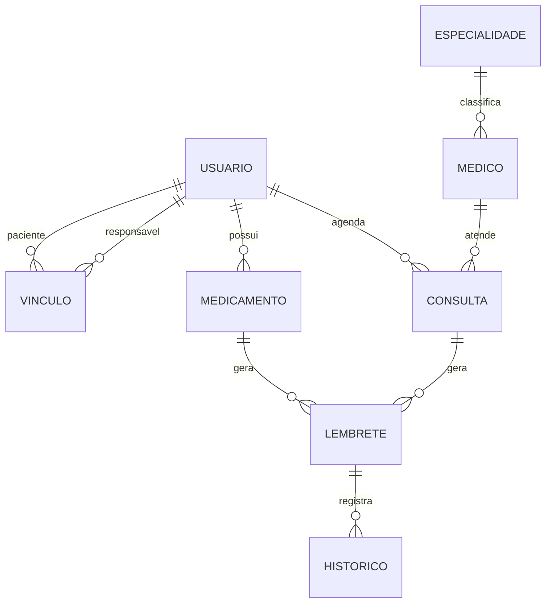

# IntegraSaúde#

> Lembretes de medicamentos e consultas com alerta automático ao responsável — projeto da disciplina de **Garantia da Qualidade de Software (Trabalho A3)**, alinhado ao **ODS 3 – Saúde e Bem-Estar**.

Esquecer uma dose ou uma consulta é comum e, para quem faz tratamento contínuo, pode ser grave. O IntegraSaúde ajuda o **paciente** a seguir o tratamento e dá tranquilidade ao **responsável** (familiar ou cuidador): se uma dose não for confirmada a tempo, o responsável é avisado automaticamente.

-------------

## Sumário

1. [Funcionalidades](#funcionalidades)
2. [Tecnologias](#tecnologias)
3. [Como rodar](#como-rodar)
4. [Demonstração em 2 minutos](#demonstração-em-2-minutos)
5. [Arquitetura](#arquitetura)
6. [Banco de dados](#banco-de-dados)
7. [Regras de negócio](#regras-de-negócio)
8. [Testes e CI](#testes-e-ci)
9. [Como contribuir](#como-contribuir)
10. [Equipe e licença](#equipe-e-licença)

------------

## Funcionalidades

- **Usuários com dois perfis:** paciente e responsável. Senha guardada com hash (PBKDF2) e login com mensagem genérica de erro.
- **Vínculo paciente ↔ responsável:** um paciente pode ter vários responsáveis e vice-versa.
- **Medicamentos:** nome, dosagem, frequência (1 a 24 h), primeiro horário e período do tratamento. Os horários do dia são calculados automaticamente.
- **Consultas:** médico, especialidade, local, data e hora, sem choque de horário para o mesmo paciente. Consulta cancelada fica registrada com status `CANCELADA`.
- **Lembretes:** gerados automaticamente em segundo plano. O paciente confirma a dose; se não confirmar dentro do tempo limite (padrão 30 min), o lembrete vira `PERDIDO`.
- **Alerta ao responsável:** enviado uma única vez quando o lembrete é perdido.
- **Histórico:** todo evento (gerado, confirmado, perdido, alerta enviado) com data e hora, consultável por paciente e por período.
- **Agenda do dia e da semana:** medicamentos e consultas juntos, em ordem de horário.
- **Busca de endereço por CEP (opcional):** integração com a API ViaCEP; se a API falhar, o endereço é digitado à mão.

## Tecnologias

| Item | Versão / uso |
| --- | --- |
| Java | 25 |
| Maven | build, testes e execução (`mvn exec:java`) |
| SQLite | persistência em arquivo, via `sqlite-jdbc` |
| JUnit 5 | testes unitários e de integração |
| GitHub Actions | CI: testes + validação do script SQL |

## Como rodar

**Pré-requisitos:** JDK 25 e Maven 3.9 ou superior.

```bash
git clone <url-do-repositorio>
cd IntegraSaude

mvn test                 # roda todos os testes
mvn compile exec:java    # abre a aplicação (cria database/integrasaude.db na primeira vez)
```

### Argumentos

Passe com `-Dexec.args="..."`, por exemplo `mvn compile exec:java -Dexec.args="--demo"`.

| Argumento | Efeito |
| --- | --- |
| `--demo` | Carrega dados fictícios, reduz o tempo limite do lembrete para 1 minuto e o agendador para 10 segundos |
| `--memoria` | Usa repositórios em memória (não grava nada em disco) |
| `--tempo-limite=N` | Minutos até um lembrete pendente virar `PERDIDO` (padrão 30) |
| `--intervalo=N` | Segundos entre as verificações do agendador (padrão 30) |
| `--banco=caminho/arquivo.db` | Arquivo do SQLite (padrão `database/integrasaude.db`) |

Os valores padrão também podem ser alterados em `src/main/resources/config.properties`.

## Demonstração em 2 minutos

```bash
mvn compile exec:java -Dexec.args="--demo"
```

1. Faça login como **paciente**: `maria@demo.com` / `Senha123`. O primeiro remédio já está marcado para cerca de 1 minuto depois da abertura.
2. Abra **Agenda → Agenda do dia** para ver os horários.
3. Aguarde o aviso `>>> [para Maria Paciente] E hora: Tomar Dipirona...` e **não confirme**.
4. Cerca de 1 minuto depois o lembrete vira `PERDIDO` e aparece o aviso `ALERTA` para o responsável.
5. Faça logout, entre como **responsável**: `joao@demo.com` / `Senha123`, e abra **Lembretes e histórico dos pacientes → Ver histórico completo**.

> Para ver o caminho feliz, confirme o lembrete em **Lembretes e histórico → Confirmar dose/consulta** antes do prazo.

## Arquitetura

O código é dividido em camadas. Cada camada só conhece as de baixo:

```
ui  →  service  →  repository (interfaces)  →  repository.jdbc (SQLite) / memória
               ↘  model, exception (não dependem de nada)
scheduler  →  service
```

| Pacote | Responsabilidade |
| --- | --- |
| `ui` | Menus do console e leitura de entrada (`Scanner`). Não tem regra de negócio |
| `service` | Regras de negócio, validações e orquestração |
| `scheduler` | Verificação periódica em segundo plano (gera lembretes, marca perdidos, alerta) |
| `repository` | Interfaces de acesso a dados e versões em memória |
| `repository.jdbc` | Implementações com SQLite |
| `model` | Entidades e enums |
| `exception` | Exceções próprias (`AppException` e filhas) |
| `config` | Leitura de argumentos, propriedades e log |
| `integracao` | Cliente da API ViaCEP |

**Regra de ouro:** `service`, `model` e `scheduler` nunca usam `Scanner`, `System.out`, SQL ou `LocalDateTime.now()` direto. O tempo vem de um `java.time.Clock` injetado, o que permite testar sem esperar tempo real.

```
IntegraSaude/
├── .github/            pipeline (ci.yml) e template de Pull Request
├── database/           scripts SQL (01 a 07) e script único de entrega
├── docs/               documentação do banco, revisão de PR e roteiro de Git
├── src/main/java/com/IntegraSaude/
│   ├── Main.java, Aplicacao.java
│   ├── config/  exception/  integracao/  model/
│   ├── repository/ (+ jdbc/)  scheduler/  service/  ui/
├── src/main/resources/ config.properties
├── src/test/java/      testes JUnit 5
└── pom.xml
```

## Banco de dados

SQLite, 8 tabelas na 3FN. Os scripts ficam em `database/` e o Maven os copia para o classpath (`db/`). Ao abrir a aplicação, o `InicializadorBanco` executa os scripts `01` a `05` em ordem; eles usam `CREATE TABLE IF NOT EXISTS`, então podem rodar a cada abertura.



| Script | Conteúdo |
| --- | --- |
| `01_usuarios.sql` | `usuario` e `vinculo` |
| `02_medicamentos.sql` | `medicamento` |
| `03_consultas.sql` | `especialidade`, `medico` e `consulta` |
| `04_lembretes.sql` | `lembrete` e `historico` |
| `05_alteracoes.sql` | coluna `telefone` em `usuario` |
| `06_dados_demonstracao.sql` | dados de exemplo para estudar o banco (os hashes são fictícios, então não servem para login) |
| `07_consultas_dql.sql` | consultas SQL de exemplo (doses perdidas, adesão ao tratamento, etc.) |
| `entrega/lembretes_completo.sql` | script único validado pela pipeline |

Detalhes (modelo conceitual, lógico, dicionário de dados): [`docs/banco-de-dados/`](docs/banco-de-dados).

**Como o código usa o banco**

- Toda conexão liga `PRAGMA foreign_keys = ON`; `SQLException` nunca chega ao menu: vira `PersistenciaException` (ou `RegistroDuplicadoException` em violação de unicidade).
- Datas e horas são gravadas como texto ISO-8601 (ex.: `2026-11-23T14:30:00`).
- O banco não guarda o paciente nem o texto de um lembrete ou de um evento do histórico: o código descobre o paciente pelo medicamento/consulta e monta o texto a partir deles.
- Cancelar consulta muda o `status` para `CANCELADA`; o horário fica livre porque o índice único só vale para consultas `AGENDADA`.
- O arquivo `*.db` não vai para o Git (está no `.gitignore`).

**Ponto de atenção:** as chaves estrangeiras de `lembrete` e `historico` usam `ON DELETE CASCADE`. Remover um medicamento (ou apagar uma consulta) também apaga os lembretes e o histórico dele.

## Regras de negócio

| # | Resumo |
| --- | --- |
| RN01 | E-mail válido e único; senha com 8+ caracteres, letra e número, guardada com hash; nome obrigatório |
| RN02 | Perfil é `PACIENTE` ou `RESPONSAVEL` |
| RN03 | Vínculo só entre paciente e responsável, sem vínculo consigo mesmo e sem duplicado |
| RN04 | Falha de login com mensagem genérica |
| RN05 | Medicamento: nome e dosagem obrigatórios, frequência de 1 a 24 h, horário inicial obrigatório, início ≤ fim, fim não pode estar no passado |
| RN06 | Todo medicamento e toda consulta pertencem a um paciente |
| RN07 | Horários calculados a partir do primeiro horário somando a frequência; nada fora do período |
| RN08 | Consulta: campos obrigatórios, não pode estar no passado, sem conflito de horário, passada não é editável |
| RN09 | Lembrete nasce `PENDENTE`; só pendente vira `CONFIRMADO` ou `PERDIDO` (estados finais) |
| RN10 | Perde-se o lembrete não confirmado em X minutos (padrão 30); confirmação tardia é rejeitada |
| RN11 | Perda alerta todos os responsáveis, uma única vez; sem vínculo não alerta e não dá erro |
| RN12 | Sem lembretes duplicados para o mesmo item e horário |
| RN13 | Todo evento vai para o histórico com data e hora |
| RN14 | Agenda mistura medicamentos e consultas em ordem; a semanal cobre 7 dias |

## Testes e CI

```bash
mvn test
```

- **Unitários (JUnit 5):** validações, senha/login, vínculo, cálculo de horários (incluindo a virada de dia), consultas, máquina de estados do lembrete, geração sem duplicados, alerta, histórico, agenda e agendador. Usam repositórios em memória e um relógio controlado, sem esperar tempo real.
- **Integração com SQLite:** `BancoIntegracaoTest` roda o fluxo completo (lembrete perdido → alerta → histórico) contra os scripts reais de `database/`, em arquivo temporário, e confere persistência, chaves estrangeiras, unicidade e leitura dos dados de demonstração do script `06`.
- **Pipeline (`.github/workflows/ci.yml`):** roda `mvn test` com JDK 25 e valida o script único do banco em um SQLite vazio.

## Como contribuir

### Fluxo de branches (Git Flow)

| Branch | Para que serve | Criada a partir de | Volta para |
| --- | --- | --- | --- |
| `main` | Versão estável entregue | - | - |
| `develop` | Integração do trabalho de todos | `main` | - |
| `feature/<nome>` | Nova funcionalidade | `develop` | `develop` (via Pull Request) |
| `refactor/<nome>` | Melhoria de código sem mudar comportamento | `develop` | `develop` (via Pull Request) |
| `hotfix/<nome>` | Correção urgente | `main` | `main` e `develop` |
| `release/<versao>` | Preparação de uma versão | `develop` | `main` e `develop` |

Regras:

1. Nunca faça commit direto em `main` ou `develop`; abra um Pull Request.
2. Antes do PR, rode `mvn test`.
3. O PR precisa de 1 aprovação e da pipeline verde.
4. Apague a branch depois do merge.

O padrão de revisão está em [`docs/REVISAO_DE_PR.md`](docs/REVISAO_DE_PR.md) e o mapa de etapas, branches e commits em [`docs/roteiro-git.md`](docs/roteiro-git.md).

### Commits semânticos

Formato: `tipo: descricao curta no imperativo`

| Tipo | Quando usar |
| --- | --- |
| `feat` | Nova funcionalidade |
| `fix` | Correção de bug |
| `test` | Criação ou ajuste de testes |
| `refactor` | Refatoração sem mudar comportamento |
| `docs` | Documentação |
| `chore` | Configuração e tarefas de manutenção |
| `ci` | Pipeline de integração contínua |

Exemplo: `feat: implementa servico de consultas`

## Equipe e licença

| Papel | Responsabilidade | Pasta |
| --- | --- | --- |
| Dev principal | Código Java, integração dos módulos e merge na `develop` | `src/main/java` |
| Testes e qualidade | Testes JUnit (TDD) e revisão de PRs | `src/test/java` |
| Banco de dados e CI | DER, scripts SQL, repositórios JDBC e GitHub Actions | `database/`, `.github/` |
| Documentação e entregas | Documentos, apresentação, vídeo e README | `docs/`, `README.md` |
